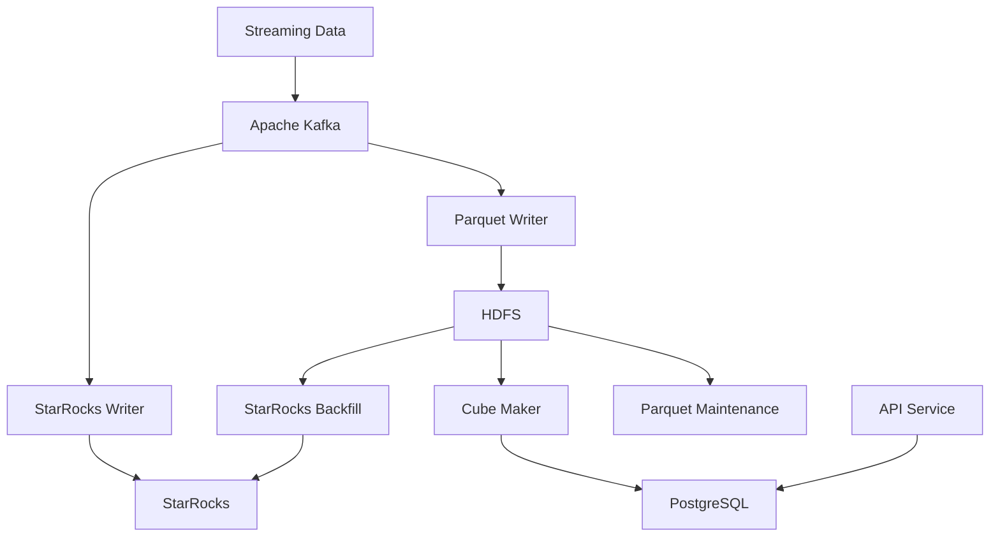

# Distributed Data Processing Pipeline

A Java-based distributed data processing system designed to ingest, process, store, and serve large volumes of streaming data using Apache Kafka, Apache Hadoop, Apache Spark, and Apache Parquet.

The project provides a modular data processing architecture that separates data ingestion, storage, analytical processing, and data access into independent components.

## Architecture

The system is built around a set of independent services that work together to support distributed data processing.



## Main Components

| Module | Description |
|---|---|
| `parquet-writer` | Consumes streaming data from Kafka and writes it to Parquet files stored in HDFS. |
| `parquet-maintenance` | Handles maintenance and management operations for Parquet data using Spark and Hadoop. |
| `starrocks-writer` | Consumes data from Kafka and writes it into StarRocks. |
| `starrocks-backfill` | Supports historical data backfilling from HDFS into StarRocks. |
| `cube-maker` | Uses Apache Spark to perform distributed data processing and generate analytical data cubes. |
| `api-service` | Provides REST APIs for accessing application data and related services. |
| `shared` | Contains common libraries and infrastructure components shared across services. |

## Technology Stack

- **Java 17** – Primary programming language.
- **Apache Kafka 3.7.2** – Distributed event streaming and message consumption.
- **Apache Spark 4.1.1** – Distributed data processing and analytical computations.
- **Apache Hadoop 3.3.6 / HDFS** – Distributed storage.
- **Apache Parquet 1.15.2** – Columnar storage format for analytical workloads.
- **Apache Avro** – Data serialization.
- **StarRocks** – Analytical database and data warehouse.
- **Spring Boot 3.5** – REST API development.
- **Maven** – Multi-module project and dependency management.
- **Micrometer & Prometheus** – Application metrics and monitoring.
- **JUnit 5, Mockito & Testcontainers** – Testing infrastructure.

## Project Structure

```text
.
├── pom.xml
└── apps/
    ├── shared/
    │   ├── config-support/
    │   ├── hdfs-support/
    │   ├── kafka-consumer-service/
    │   └── metrics/
    │
    ├── parquet-writer/
    ├── parquet-maintenance/
    ├── starrocks-writer/
    ├── starrocks-backfill/
    ├── cube-maker/
    └── api-service/
```

## Building the Project

### Prerequisites

- Java 17
- Apache Maven
- Access to the required infrastructure services (Kafka, HDFS, StarRocks, and PostgreSQL, depending on the module).

### Clone the Repository

```bash
git clone https://github.com/SeyyedAhmadRokni/Distributed-Data-Processing-Pipeline.git

cd Distributed-Data-Processing-Pipeline
```

### Build All Modules

```bash
mvn clean package
```

### Run Tests

```bash
mvn test
```

### Build a Specific Module

For example, to build the Parquet Writer module:

```bash
mvn clean package -pl apps/parquet-writer -am
```

The `-am` option also builds the required modules that the selected module depends on.

## Container Images

The project uses the Jib Maven Plugin to build container images for individual services without requiring a Dockerfile.

Container image configuration is defined in the Maven module configurations.

## Testing

The project uses several testing tools:

- **JUnit 5** for unit testing.
- **Mockito** for mocking dependencies.
- **Testcontainers** for integration testing with containerized infrastructure.
- **Hadoop MiniCluster** for testing HDFS-related functionality.